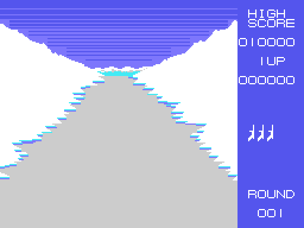
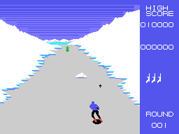
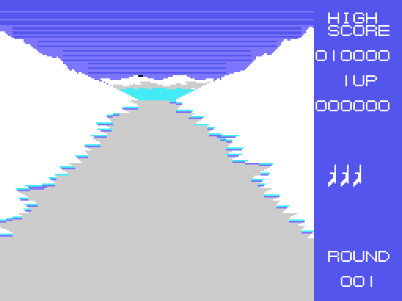
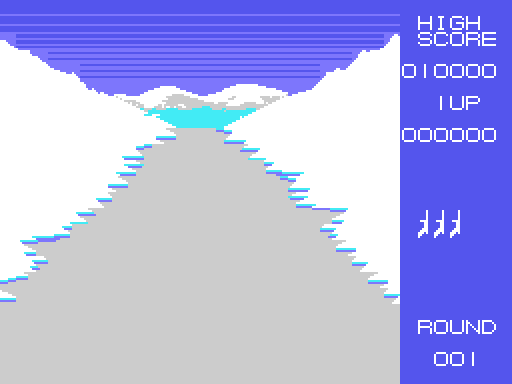
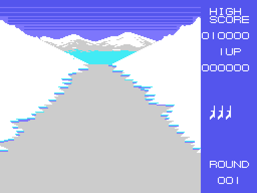

# The course

This picture is not a screenshot: it comes from **running the ROM** with
`tools/pantallas.py` (the Z80 of `tools/z80run.py` with the BIOS routines the game
uses, written by hand in `tools/bios.py`), from `ronda` (0x80CD) to the round loop
(0x8255). Checked against openMSX's VRAM at the start of round 1: **0 different
pixels** out of 49,152, and the name table, the patterns and the colours identical
byte for byte.

The screen has two parts. The **top eight rows** are the mountain and the snow in
the background: a strip of 31 tiles per row in RAM (0xE000) of which 25 are copied
to the screen, starting at the column of the bend (`pista_pinta`, 0x9139). Below
it, the course in perspective: plain tiles (tile 2) with the snow at the edges in
steps and **stripes** that move down.

## The stripes

The course does not move: what gives the feeling of going down are the stripes at
the sides, ten drawings of ten rows painted one after the other (`pista`, 0x8FF3,
with the tables 0x919F and 0x91D1). How many frames pass between them is set by
the difficulty: every 16 in the first three rounds, every 8 after that.

## The bends

Every so often, at random, a bend starts (`ronda_curva`, 0x86F3): four steps to one
side, and the column the top strip is copied from moves by one tile every eight
frames, between 0 and 30 (`pista_curva`, 0x90A8). The mountain in the background
changes its drawing depending on the side. From stretch 12 of the round there are no
new bends, and when the round ends the course is straight again.

## The four stretches of snow

A round lasts about **14 x 256 frames** (a little over a minute): the frame counter
(0xE881) goes up on every interrupt, and its high byte (0xE882) is the **stretch**.
Every 256 frames, `tramo` (0x97B2) loads the background snow that is due: one for
stretches 0 to 3, another for 4 to 7, another for 8 to 11 and the last one from 12
on (the tables 0xAF35, 0xB02D, 0xB06B and 0xB0C8, and their patterns from 0xB144).
From stretch 14 on, once there are no enemies or flying machine left on screen, the
round ends.

| stretches 4 to 7 | stretches 8 to 11 | stretches 12 on |
|---|---|---|
|  |  |  |

## Trees and rocks

The objects on the course **are not sprites but tiles**: ten at a time (0xE8B0),
each with its place in the name table, its type and its step. They come down with
the course and grow as they get closer: on each step they are erased, moved one
row down and painted again with the drawing of their size (`objeto`, 0x9218; the
tables 0x92D8, 0x9368 and 0x9390). A new one comes out every 112 frames, of one of
20 types (`ronda_objeto`, 0x871E; the table 0x8793), and in the first three rounds
without types 10 to 14.

Since they are tiles, the collisions with them are checked by reading the VRAM
(`choques_pista`, 0x89D7): what the skier has under his skis.

## The six difficulties

The round picks a row of the table 0x84A4 (`ronda_dificultad`, 0x8231): round 1 uses
the first, round 2 the second... and from round 6 on the fifth and the sixth
alternate.

| round | flying machine | enemy step | things dropped | stripes every |
|---|---|---|---|---|
| 1 | no | 1 | no | 16 frames |
| 2 | yes | 1 | no | 16 |
| 3 | yes | 2 | yes | 16 |
| 4 | yes | 2 | yes | 8 |
| 5, 7, 9... | yes | 3 | yes | 8 |
| 6, 8, 10... | yes | 3 | yes, faster | 8 |
