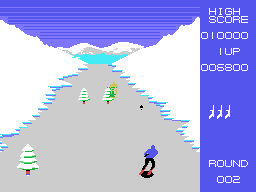
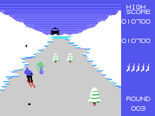

# The enemies

## The skiers

Up to **four** at a time (0xE8E2, four bytes each: Y, X, step and type). They come
out when their counter runs out, one in 32 frames at random, through the middle of
the course or on the side of the bend, and they are of **seven types**, 1 to 7: the
two colours change (0x8E03), the body's and the legs' (`enemigo_nuevo`, 0x8D59).

They move one frame in four (`enemigo`, 0x8C44). Before moving on they **look at
the course ahead** by reading the VRAM: if there is a tree or a rock, they step to
one side at random; if both sides are taken, they slow down. With the way clear and
once in the lower half of the screen, they **head for the skier's X**. They have
four sizes depending on how close they are, and the biggest one comes down faster
and makes a sound (`enemigo_sube`, 0x8D16). Below the screen they leave.

A shot less than 6 pixels away knocks one down (100 points): it becomes type 0 and
falls with its four knocked-down drawings (0x8E3F).

## The flying machine

From round 2, every now and then, a **flying machine** on skids comes out through
the middle or one side (from its shape, a helicopter; the game does not name it).
It heads for the skier's X and comes closer through the sky: the higher on the
screen, the bigger, with **four sizes** (`aparato_mueve`, 0x8AA8; the sizes in
sprites, at 0x8BDE). It comes in one of three colours at random: black, light red
or white (0x8BDB).

The normal shot goes up towards the course; to hit the machine, the shot **has to
be fired during a jump** (`disparo_tipo`, 0x8E82). Each hit gives 200 points and an
explosion. If the one hit is the **black** one, it is left **hit** (0xE8AA): it moves
away upwards with the explosion and, if another shot catches it meanwhile, **an
extra life** (`disparo_aparato`, 0x8F58).

## What it drops

From round 3 the flying machine drops things: one time in 64, from where it is, it
comes down at the round's pace and faster below Y 0x50 (`cae`, 0x8B85). If it
touches the skier, he crashes, even during a jump.
