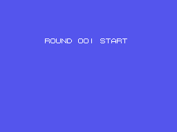
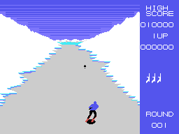
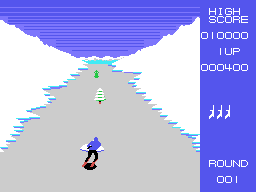

# The game

A commando skis down a course seen from behind. He has to dodge the trees, the
rocks and the snow at the edges, get rid of the enemy skiers and of the machine
that comes flying, and reach the end of the round. Then comes PATTERN CLEAR, a
bonus round shooting at three targets, and the next round. All that is in
[The course](THE-COURSE.html), [The enemies](THE-ENEMIES.html) and
[The sequences](THE-SEQUENCES.html).

Every GIF on this site is the ROM **running in openMSX** (a Japanese MSX1, at 60
frames per second): on every frame the VRAM and the VDP registers are logged, and
`tools/vdp.py` paints them. Each picture lasts as long as it did in the emulator.

## The controls

The cursor keys, the first joystick and the second one all do the same: the game
merges the three directions (`mando_direccion`, 0x860E). **Fire** is the space bar
or the first button of either joystick; **jump** is the second button of a
joystick or the **GRAPH** key (`lee_botones`, 0x863D).

The skier moves from side to side across the course and a little up and down the
screen: Y between 0x88 and 0xA0. Up goes one pixel per frame and down, two every
four frames (`mueve`, 0x88C4).

## The shot

Only one at a time. It leaves the skier when fire has **just been pressed** (the
button has to be released between shots) and climbs four pixels per frame
(`disparo`, 0x8E5B). It hits the enemy skiers, the flying machine and some tiles of
the course; trees and rocks stop it.

## The jump

With the second button the skier jumps for **91 frames** (`salto`, 0x885F): he goes
up from frame 2 to 34, stays up, comes down from 43 to 74 and lands. His shadow
stays on the ground and changes size along the jump. During the first 80 frames
of the jump he does not collide with the enemies or the course (only with what the
machine drops), and the shot goes towards the flying machine.

## The collisions

Every frame, `choques` (0x8991) checks:

- whether the skier leaves the course at the sides;
- the four enemy skiers, less than 12 pixels away in Y and 13 in X;
- the course tile under his skis, read from the name table: if it is neither
  plain course nor snow, he crashes;
- what the flying machine drops, less than 8 pixels away.

A crash is stored in 0xE8FA and the round stops: the skier falls, his tune plays,
a life is lost and **the round starts again from the beginning** (`bucle_ronda`,
0x8255).

## Points and lives

The points are kept in 0xE90A divided by 100, so on screen they always end in 00:

| | points |
|---|---:|
| an enemy skier | 100 |
| a hit on the flying machine | 200 |
| one of the course tiles that can be shot | 1,000 |
| the bonus targets | 3,000, 2,000 and 1,000 |

The game starts with **four lives**, the one being played and three in reserve
(`presentacion`, 0x8036). There is an extra life **every 10,000 points**
(`marcador_vida`, 0x9454), and another one for finishing off the flying machine
once it has been hit (see [The enemies](THE-ENEMIES.html)). The high score starts
at 10,000.
