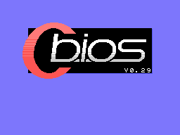
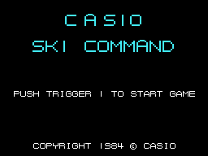
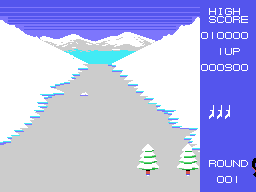
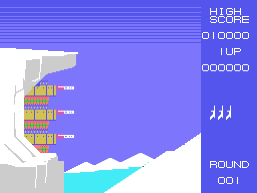
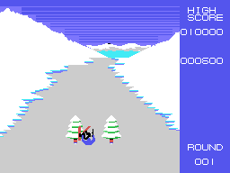

# The sequences

## The title

`presentacion` (0x8036) paints six signs from the table 0x84BC (address in the name
table, length and letters): CASIO and SKI COMMAND in **big letters** two tiles high,
PUSH TRIGGER 1 TO START GAME and the COPYRIGHT. The big letters are 16 tiles of
their own (0xB774); the small ones, the game's font (0xB7F4). The title screen comes
straight out of running the ROM, and matches openMSX's dot for dot.

## The demo

If fire is not pressed in **512 frames**, the demo starts (`espera_titulo`, 0x80A8):
a round 1 with one life, without the round sign and **without music**, in which the
skier changes direction at random every so often, fires almost all the time and
jumps one time in 16 (`mando`, 0x85F1). A button stops it and goes back to the title.

## The round

Before each round, with the screen off, the patterns of the course and the score
panel are loaded and ROUND 001 START is shown for 128 frames (`ronda`, 0x80CD). In
round 1 the starting tune plays first.

## The crash

On a crash, `bucle_ronda` (0x8255) keeps the first four sprites and swaps the skier
for **three falling drawings** (0xA9ED), five times of eight frames. The crash tune
plays; then a life is lost and the round starts again.

## PATTERN CLEAR and the bonus

When the round ends PATTERN CLEAR comes up with its tune, and then the **bonus**
(`pattern_clear`, 0x830C): a new screen with a cliff and three targets on the wall.

The bonus skier **is not steered**: he follows a fixed path (0x9507, points of 7
bytes, `recorrido`, 0x94A1). What the player does is **shoot**: the shot leaves the
skier in the direction of his drawing at that moment (`bonus_dispara`, 0x95B6; the
table 0x95E0). The target that gets a shot spins and gives its points: **3,000,
2,000 or 1,000**, from top to bottom (`bonus_disparo`, 0x9535). When the path is
over the next round starts.

The bonus screen comes from running the ROM from 0x8323 on top of what the round
leaves (the bonus does not reload the font) and matches openMSX's except for **one
tile**, the one with the points on the score panel, which in openMSX already shows
those of the game.

## GAME OVER

With no lives left, GAME OVER on row 7 with its tune, and when it ends, the title.
