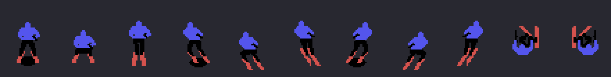
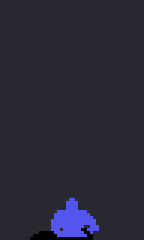
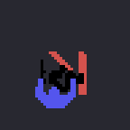
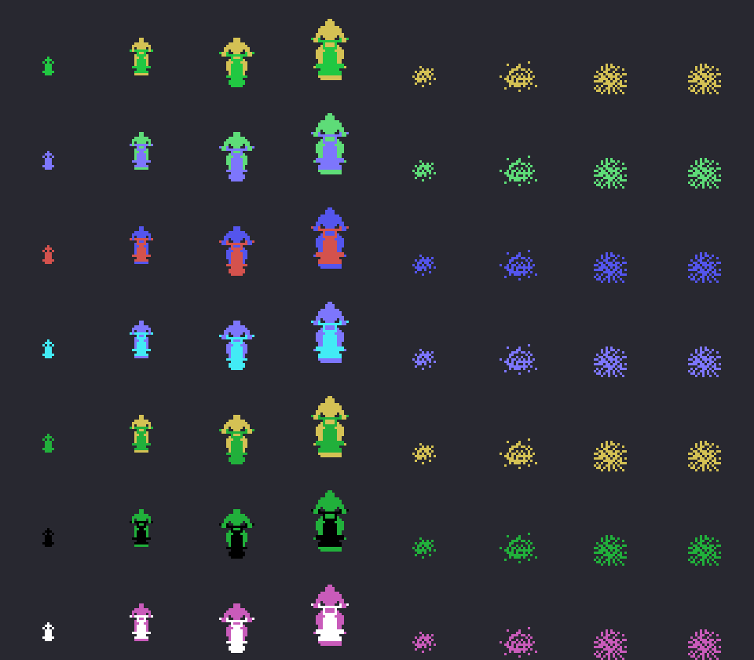
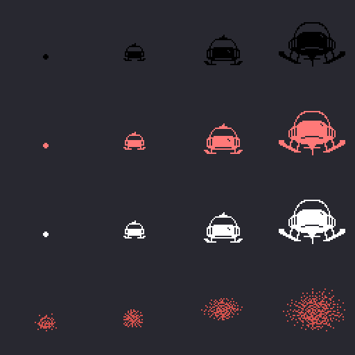
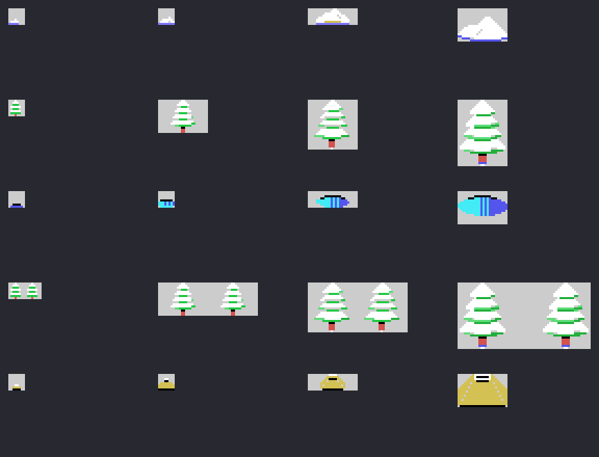

# The sprites

Everything on this page is **put together from the ROM tables** with `tools/hojas.py`: the sprite drawings loaded the
way the game loads them and each character built from its own sprite lists, offsets and colours. None of these
images is a screenshot.

**Checked against openMSX** on the three recordings of this site: the sprite drawing table built here (VRAM
0x3800-0x3FFF) is **identical** to the game's on 17,989 frames (the other 14 are half-done loads and the bonus, which
puts other drawings there), and what is built matches the game's copy of the sprite table (0xE800) on **14,816 frames
of the skier and 2,921 of the flying machine, 0 different**. Of the course objects, 11 of the 12 large ones appear
whole in the recorded name tables.

## The drawings

They are 16 x 16. The game loads six of the skier (0xA1CD) at 0x3800 and, after them, the next six (0xA28D) as they
are and **flipped sideways** (`sprites_girados`, 0x9635: each 8-dot half with its bits reversed and the two halves
swapped): that way the left-facing drawings take no room in the ROM. The other 46 (0xA34D) go from 0x3A40. When the
skier crashes, the three drawings of the fall (0xA9ED) go on top, also with their flipped copies.

## The skier

Eleven four-sprite drawings (0x8910: the Y and X offsets and the drawing of each), with the colours of its four
sprites (0x8465): dark blue, black, dark red and the black shadow. Straight (0), left (3) and right (6), each with the
**take-off** (+1) and **in the air** (+2, without the shadow: three are drawn in the air), and the two of the
**crash** (9 and 10).

The jump, frame by frame as `salto` (0x885F) does it: the take-off, the air drawing two frames later, 33 dots up (one
per frame), a wait, as many down, the landing at 75 and standing again at 91; the shadow stays on the ground and
changes size (drawings 0x4C, 0x50, 0x4C and 0x48).

The crash (0x827B): drawings 9 and 10, one the flipped copy of the other, every 8 frames, five times.

## The enemies

Seven kinds, each with its two colours (0x8E03: the body and the legs), in **four sizes** depending on how close they
are (0x8E13: how many sprites and, for each, the Y and X offsets, the drawing and which of the two colours), and the
four drawings of the **knocked-down** one (0x8E3F).

## The flying machine

In its three colours (0x8BDB: black, light red and white) and four sizes (0x8BEE: the offset and the drawings by rows;
0x8BDE the rows and the sprites in each), and **hit** (drawings 4 to 7): when it is hit, its colour byte becomes 6
(0x8FC6), which is why the explosion is always dark red.

An oddity that shows up in the check: the offset is added as a word (`add hl,de`, 0x8B59), with the Y in the low byte
and the X in the high one, so the carry from the Y spills into the X and the machine sits **one dot further right**
than its table says.

## The course objects

They are not sprites: they are screen tiles. Five objects in four sizes (0x9390: the tiles row by row; 0x9368, the
rows and the tiles in each), with the course tiles (0x9FED) and the snow tiles (0xAA4D) and their colours. By their
look: a snow mound, a tree, a blue puddle, two trees and a rock. Tile 2 is the smooth course: it acts as a gap.

