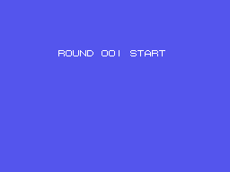
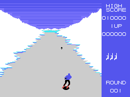
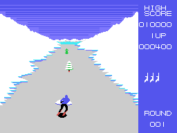

# La partida

Un comando baja esquiando por una pista vista desde atrás. Tiene que esquivar
los árboles, las rocas y los bordes de nieve, quitarse de encima a los
esquiadores enemigos y al aparato que viene volando, y llegar al final de la
ronda. Entonces sale PATTERN CLEAR, una ronda de bonus disparando a tres dianas
y la ronda siguiente. Todo eso está en [La pista](LA-PISTA.html),
[Los enemigos](LOS-ENEMIGOS.html) y [Las secuencias](LAS-SECUENCIAS.html).

Todos los GIF de esta web son la ROM **funcionando en openMSX** (un MSX1
japonés, a 60 cuadros por segundo): en cada cuadro se apuntan la VRAM y los
registros del VDP, y `tools/vdp.py` los pinta. Cada imagen dura lo que duró en
el emulador.

## Los mandos

Los cursores, el primer mando y el segundo valen lo mismo: el juego junta las
tres direcciones (`mando_direccion`, 0x860E). El **disparo** es la barra o el
primer botón de cualquier mando; el **salto**, el segundo botón de un mando o
la tecla **GRAPH** del teclado (`lee_botones`, 0x863D).

El esquiador va de lado a lado de la pista y sube o baja un poco en la pantalla:
la Y entre 0x88 y 0xA0. Hacia arriba va un punto cada cuadro y hacia abajo,
dos cada cuatro cuadros (`mueve`, 0x88C4).

## El disparo

Solo hay uno en el aire. Sale del esquiador con el disparo **recién pulsado**
(hay que soltar el botón entre uno y otro) y sube cuatro puntos por cuadro
(`disparo`, 0x8E5B). Da a los esquiadores enemigos, al aparato y a algunas
casillas de la pista; los árboles y las rocas lo paran.

## El salto

Con el segundo botón, el esquiador salta durante **91 cuadros** (`salto`,
0x885F): sube del cuadro 2 al 34, se queda arriba, baja del 43 al 74 y cae. Su
sombra se queda en el suelo y cambia de tamaño a lo largo del salto. Durante los
primeros 80 cuadros del salto no choca con los enemigos ni con la pista (solo con
lo que cae del aparato), y el disparo va hacia el aparato.

## Los choques

En cada cuadro, `choques` (0x8991) mira:

- si el esquiador se sale por los lados de la pista;
- los cuatro esquiadores enemigos, a menos de 12 puntos en Y y 13 en X;
- la casilla de la pista que tiene debajo de los esquís, en la tabla de
  nombres: si no es pista lisa ni nieve, choque;
- lo que cae del aparato, a menos de 8 puntos.

Un choque se apunta en 0xE8FA y la ronda se para: el esquiador cae, suena
su música, se pierde una vida y **la ronda vuelve a empezar desde el
principio** (`bucle_ronda`, 0x8255).

## Los puntos y las vidas

Los puntos se guardan en 0xE90A divididos entre 100, así que en pantalla
siempre acaban en 00:

| | puntos |
|---|---:|
| un esquiador enemigo | 100 |
| un golpe al aparato | 200 |
| una de las casillas que se pueden disparar en la pista | 1.000 |
| las dianas del bonus | 3.000, 2.000 y 1.000 |

La partida empieza con **cuatro vidas**, la que se juega y tres de reserva
(`presentacion`, 0x8036). Hay una vida extra **cada 10.000 puntos**
(`marcador_vida`, 0x9454), y otra al rematar el aparato cuando ya está tocado
(ver [Los enemigos](LOS-ENEMIGOS.html)). El récord empieza en 10.000.
