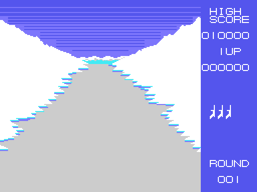
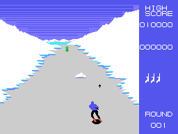
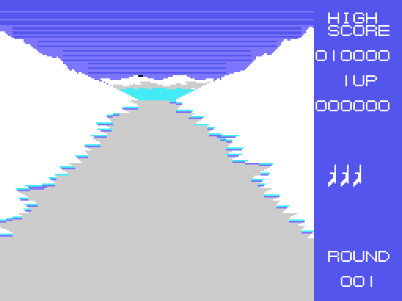
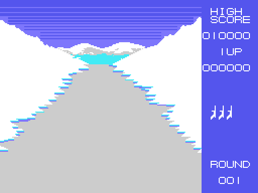
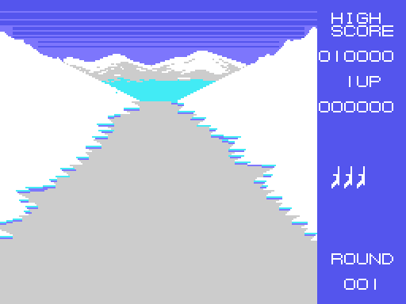

# La pista

Esta imagen no es una captura: sale de **ejecutar la ROM** con
`tools/pantallas.py` (el Z80 de `tools/z80run.py` con las rutinas de la BIOS
que usa el juego, hechas a mano en `tools/bios.py`), desde `ronda` (0x80CD)
hasta el bucle de la ronda (0x8255). Cotejada con la VRAM de openMSX al
empezar la ronda 1: **0 puntos distintos** de 49.152, y la tabla de nombres,
los dibujos y los colores, iguales byte a byte.

La pantalla tiene dos partes. Las **ocho filas de arriba** son el monte y la
nieve del fondo: una tira de 31 casillas por fila en la RAM (0xE000) de la que
se copian 25 a la pantalla, empezando en la columna de la curva
(`pista_pinta`, 0x9139). Por debajo, la pista en perspectiva: casillas lisas
(la 2) con la nieve de los bordes en escalera y **rayas** que bajan.

## Las rayas

La pista no se mueve: lo que da la sensación de bajar son las rayas de los
lados, diez dibujos de diez filas que se van pintando uno detrás de otro
(`pista`, 0x8FF3, con las tablas 0x919F y 0x91D1). Cuántos cuadros pasan entre
uno y otro lo dice la dificultad: cada 16 en las tres primeras rondas, cada 8
después.

## Las curvas

Cada tanto, al azar, empieza una curva (`ronda_curva`, 0x86F3): cuatro pasos a
un lado, y la columna desde la que se copia la tira de arriba se corre una casilla
cada ocho cuadros, entre 0 y 30 (`pista_curva`, 0x90A8). El monte del fondo
cambia de dibujo según el lado. Desde el tramo 12 de la ronda ya no hay curvas
nuevas, y al acabar la ronda la pista vuelve a estar recta.

## Los cuatro tramos de nieve

Una ronda dura unos **14 x 256 cuadros** (algo más de un minuto): el contador
de cuadros (0xE881) sube en cada interrupción, y su parte alta (0xE882) es el
**tramo**. Cada 256 cuadros, `tramo` (0x97B2) carga la nieve del fondo que toca:
una para los tramos 0 a 3, otra del 4 al 7, otra del 8 al 11 y la última del 12
en adelante (las tablas 0xAF35, 0xB02D, 0xB06B y 0xB0C8, y sus dibujos desde
0xB144). Del tramo 14 en adelante, cuando ya no quedan enemigos ni aparato en
pantalla, la ronda se acaba.

| tramos 4 a 7 | tramos 8 a 11 | tramos 12 en adelante |
|---|---|---|
|  |  |  |

## Los árboles y las rocas

Los objetos de la pista **no son sprites sino casillas**: diez a la vez
(0xE8B0), cada uno con su sitio en la tabla de nombres, su tipo y su paso. Bajan
con la pista y crecen al acercarse: en cada paso se borran, bajan una fila y se
vuelven a pintar con el dibujo de su talla (`objeto`, 0x9218; las tablas
0x92D8, 0x9368 y 0x9390). Salen cada 112 cuadros, de uno de 20 tipos
(`ronda_objeto`, 0x871E; la tabla 0x8793), y en las tres primeras rondas sin
los tipos 10 a 14.

Como son casillas, los choques con ellos se miran leyendo la VRAM
(`choques_pista`, 0x89D7): lo que el esquiador tiene debajo de los esquís.

## Las seis dificultades

La ronda elige una fila de la tabla 0x84A4 (`ronda_dificultad`, 0x8231): la 1
usa la primera, la 2 la segunda... y de la 6 en adelante se alternan la quinta y
la sexta.

| ronda | aparato | paso de los enemigos | lo que cae | rayas cada |
|---|---|---|---|---|
| 1 | no | 1 | no | 16 cuadros |
| 2 | sí | 1 | no | 16 |
| 3 | sí | 2 | sí | 16 |
| 4 | sí | 2 | sí | 8 |
| 5, 7, 9... | sí | 3 | sí | 8 |
| 6, 8, 10... | sí | 3 | sí, más deprisa | 8 |
