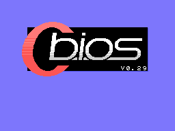
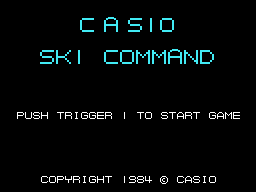
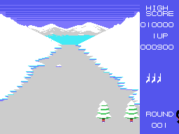
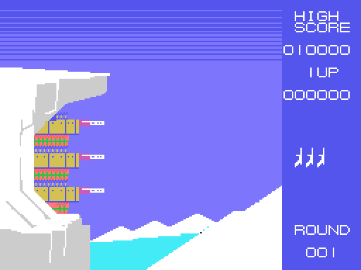
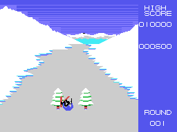

# Las secuencias

## El título

`presentacion` (0x8036) pinta seis carteles desde la tabla 0x84BC (dirección
en la tabla de nombres, longitud y letras): CASIO y SKI COMMAND en **letras
grandes** de dos casillas de alto, PUSH TRIGGER 1 TO START GAME y el COPYRIGHT.
Las letras grandes son 16 casillas propias (0xB774); las pequeñas, la fuente
del juego (0xB7F4). La pantalla del título sale tal cual de ejecutar la ROM, y
coincide punto a punto con la de openMSX.

## La demo

Si en **512 cuadros** no se pulsa el disparo, empieza la demo (`espera_titulo`,
0x80A8): una ronda 1 con una vida, sin cartel de ronda y **sin música**, en la
que el esquiador cambia de dirección al azar cada tanto, dispara casi siempre y
salta una vez de cada 16 (`mando`, 0x85F1). Un botón la corta y vuelve al título.

## La ronda

Antes de cada ronda, con la pantalla apagada, se cargan los dibujos de la pista
y del marcador y se ve ROUND 001 START durante 128 cuadros (`ronda`, 0x80CD).
En la ronda 1 suena antes la música de salida.

## La caída

Al chocar, `bucle_ronda` (0x8255) se queda con los cuatro primeros sprites y
cambia el esquiador por **tres dibujos de caída** (0xA9ED), cinco veces de ocho
cuadros. Suena la música del choque; después se pierde una vida y la ronda
empieza otra vez.

## PATTERN CLEAR y el bonus

Al acabar la ronda sale PATTERN CLEAR con su música, y después el **bonus**
(`pattern_clear`, 0x830C): una pantalla nueva con un acantilado y tres dianas
en la pared.

El esquiador del bonus **no se maneja**: hace un recorrido fijo (0x9507, puntos
de 7 bytes, `recorrido`, 0x94A1). Lo que hace el jugador es **disparar**: el
disparo sale del esquiador con la dirección de su dibujo en ese momento
(`bonus_dispara`, 0x95B6; la tabla 0x95E0). La diana que recibe un
disparo gira y da sus puntos: **3.000, 2.000 o 1.000**, de arriba abajo
(`bonus_disparo`, 0x9535). Al acabar el recorrido empieza la ronda siguiente.

La pantalla del bonus sale de ejecutar la ROM desde 0x8323 sobre lo que deja la
ronda (el bonus no vuelve a cargar la fuente) y coincide con la de openMSX salvo
**una casilla**, la de los puntos del marcador, que en openMSX ya tiene los de
la partida.

## GAME OVER

Sin vidas, GAME OVER en la fila 7 con su música, y al acabar, el título.
