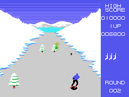
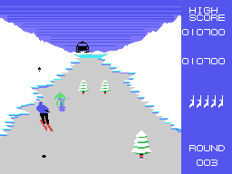

# Los enemigos

## Los esquiadores

Hasta **cuatro** a la vez (0xE8E2, cuatro bytes cada uno: Y, X, paso y tipo).
Salen al acabar su cuenta, uno de cada 32 cuadros al azar, por el centro de la
pista o por el lado de la curva, y son de **siete tipos** de 1 a 7: cambian los
dos colores (0x8E03), el del cuerpo y el de las piernas (`enemigo_nuevo`,
0x8D59).

Se mueven uno de cada cuatro cuadros (`enemigo`, 0x8C44). Antes de avanzar
**miran la pista que tienen delante** leyendo la VRAM: si hay un árbol o una roca,
se apartan a un lado al azar; si los dos lados están ocupados, frenan. Con el
camino libre y ya en la mitad de abajo de la pantalla, **van hacia la X del
esquiador**. Según lo cerca que están tienen cuatro tallas, y la más grande baja
más deprisa y suena (`enemigo_sube`, 0x8D16). Por abajo de la pantalla se van.

Un disparo a menos de 6 puntos lo derriba (100 puntos): pasa a tipo 0 y cae con
sus cuatro dibujos de derribado (0x8E3F).

## El aparato

Desde la ronda 2 sale de vez en cuando, por el centro o por un lado, un
**aparato volador** con patines (por la forma, un helicóptero; el juego no lo
nombra). Va hacia la X del esquiador y se acerca por el cielo: cuanto más arriba
de la pantalla, más grande, con **cuatro tallas** (`aparato_mueve`, 0x8AA8;
los tamaños en sprites, en 0x8BDE). Sale de uno de tres colores al azar: negro,
rojo claro o blanco (0x8BDB).

El disparo normal sube hacia la pista; para darle, el disparo **tiene que salir
durante el salto** (`disparo_tipo`, 0x8E82). Cada golpe da 200 puntos y una
explosión. Si el que recibe el golpe es el **negro**, queda **tocado** (0xE8AA): se
aleja hacia arriba con la explosión y, si en ese rato otro disparo le acierta,
**una vida más** (`disparo_aparato`, 0x8F58).

## Lo que cae

Desde la ronda 3, el aparato suelta cosas: una de cada 64 veces, desde donde
está, baja al paso de la ronda y más deprisa por debajo de la Y 0x50
(`cae`, 0x8B85). Si toca al esquiador, choque, también en el salto.
