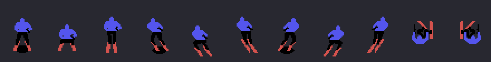
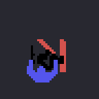
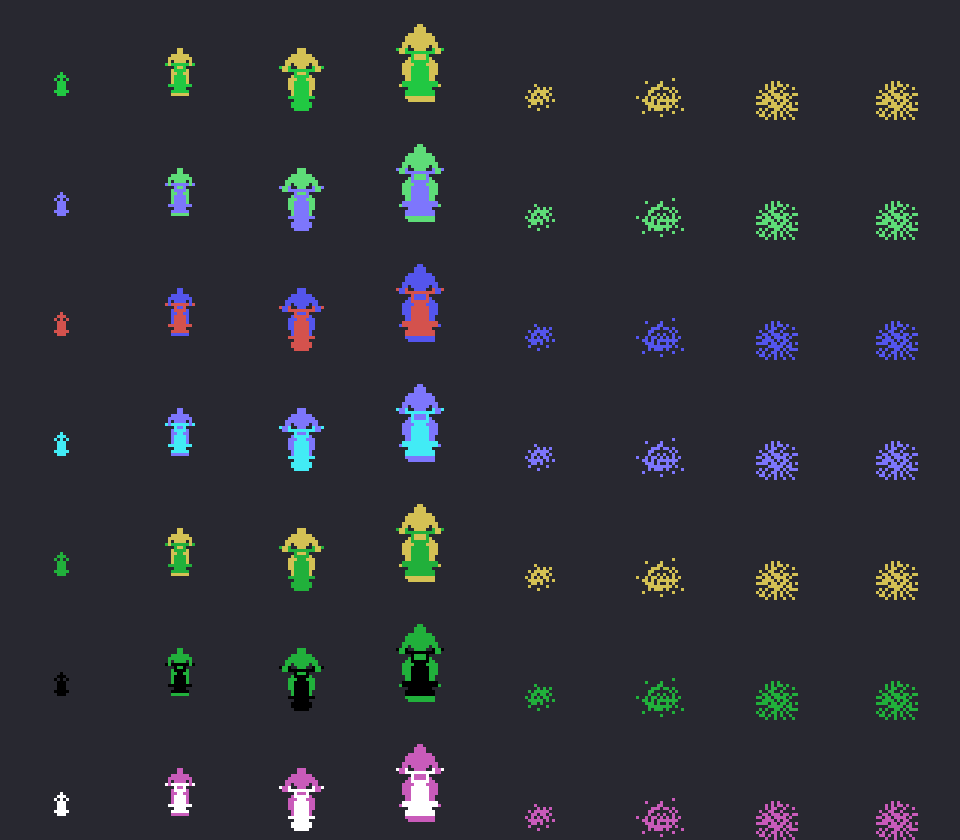
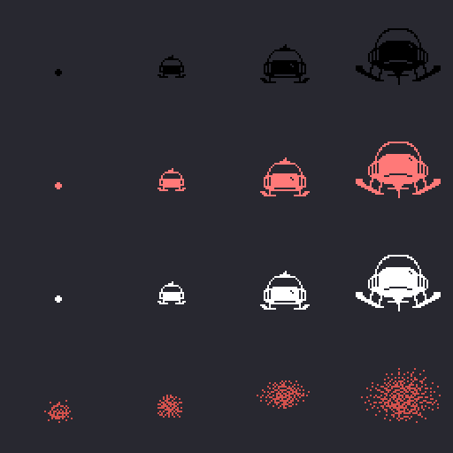
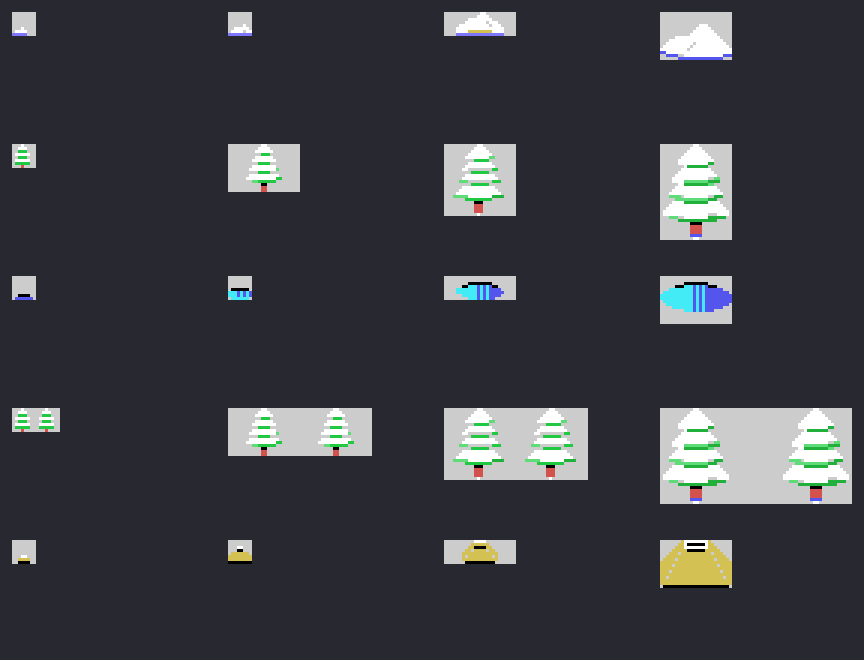

# Los sprites

Todo lo de esta p&aacute;gina est&aacute; **montado desde las tablas de la ROM** con `tools/hojas.py`: los dibujos de
los sprites cargados como los carga el juego y cada personaje compuesto con sus propias listas de sprites, sus
desplazamientos y sus colores. Ninguna imagen es una captura.

**Cotejado con openMSX** en las tres grabaciones de la web: la tabla de dibujos de los sprites (VRAM 0x3800-0x3FFF)
que se monta aqu&iacute; es **id&eacute;ntica** a la del juego en 17.989 cuadros (los 14 restantes son cargas a
medias y el bonus, que pone otros dibujos), y lo compuesto casa con la copia de la tabla de sprites del juego
(0xE800) en **14.816 cuadros del esquiador y 2.921 del aparato, 0 distintos**. De los objetos de la pista, 11 de los
12 grandes salen enteros en las tablas de nombres grabadas.

## Los dibujos

Son de 16 x 16. El juego carga seis del esquiador (0xA1CD) en 0x3800 y, detr&aacute;s, los seis siguientes (0xA28D)
tal cual y **girados de lado** (`sprites_girados`, 0x9635: cada mitad de 8 puntos con los bits al rev&eacute;s y las
dos mitades cambiadas): as&iacute; los dibujos hacia la izquierda no ocupan sitio en la ROM. Los 46 del resto
(0xA34D) van desde 0x3A40. Al caerse, pone encima los tres del esquiador que se cae (0xA9ED), tambi&eacute;n con sus
girados.

## El esquiador

Once dibujos de cuatro sprites (0x8910: la diferencia en Y, en X y el dibujo de cada uno), con los colores de sus
cuatro sprites (0x8465): azul oscuro, negro, rojo oscuro y la sombra negra. Recto (0), a la izquierda (3) y a la
derecha (6), cada uno con el **despegue** (+1) y **en el aire** (+2, sin sombra: en el aire se pintan tres), y los dos
de la **ca&iacute;da** (9 y 10).

El salto, cuadro a cuadro como lo hace `salto` (0x885F): el despegue, el dibujo del aire a los dos cuadros, 33 puntos
hacia arriba (uno por cuadro), una espera, otros tantos hacia abajo, el aterrizaje en el 75 y de pie en el 91; la
sombra se queda en el suelo y cambia de tama&ntilde;o (los dibujos 0x4C, 0x50, 0x4C y 0x48).

La ca&iacute;da (0x827B): los dibujos 9 y 10, uno girado del otro, cada 8 cuadros, cinco veces.

## Los enemigos

Siete tipos, cada uno con sus dos colores (0x8E03: el del cuerpo y el de las piernas), en **cuatro tama&ntilde;os**
seg&uacute;n lo cerca que est&aacute;n (0x8E13: cu&aacute;ntos sprites y, de cada uno, la diferencia en Y y en X, el
dibujo y cu&aacute;l de los dos colores), y los cuatro dibujos del **derribado** (0x8E3F).

## El aparato

En sus tres colores (0x8BDB: negro, rojo claro y blanco) y cuatro tama&ntilde;os (0x8BEE: el desplazamiento y los
dibujos por filas; 0x8BDE las filas y los sprites de cada una), y **tocado** (los dibujos 4 a 7): al tocarlo, el byte
de su color pasa a ser el 6 (0x8FC6), y por eso la explosi&oacute;n es siempre roja oscura.

Una rareza que se ve al cotejar: el desplazamiento se suma como una palabra (`add hl,de`, 0x8B59), con la Y en el byte
bajo y la X en el alto, as&iacute; que el acarreo de la Y pasa a la X y el aparato sale **un punto m&aacute;s a la
derecha** de lo que dice su tabla.

## Los objetos de la pista

No son sprites: son casillas de la pantalla. Cinco objetos en cuatro tallas (0x9390: las casillas fila a fila;
0x9368, las filas y las casillas de cada una), con las casillas de la pista (0x9FED) y de la nieve (0xAA4D) y sus
colores. Por su dibujo: un mont&iacute;culo de nieve, un &aacute;rbol, un charco azul, dos &aacute;rboles y una roca.
La casilla 2 es la pista lisa: hace de hueco.

